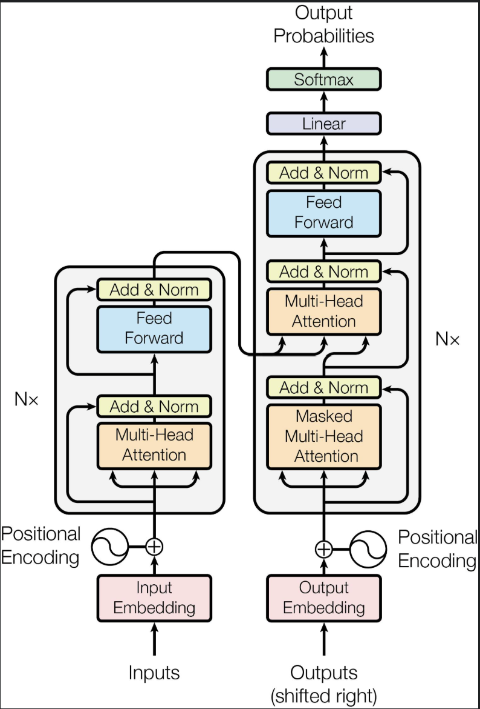
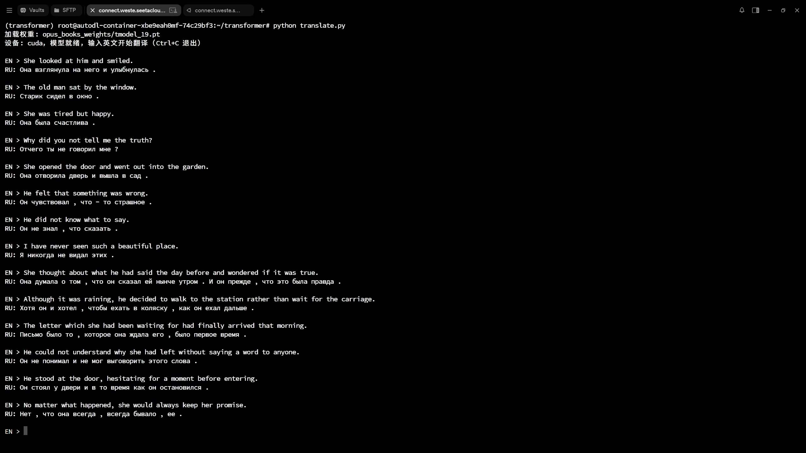

> 实现以前需要了解一些 Pytorch 操作与概念，尤其是广播机制和 Pytorch 的 nn 库的基本操作。
> Pytorch操作，可参照 [tensor.py · wjlwjlwjlwjl-cmd/Transformer - 码云 - 开源中国](https://gitee.com/wangs-joyful-home/transformer/blob/master/tensor.py)；一些相关概念与计算方式，可参照 [手推 Transformer：一文搞懂 Self-Attention、Multi-Head Attention 与 Encoder/Decoder_手推transformer-CSDN博客](https://blog.csdn.net/wangjialelele/article/details/164402946?spm=1001.2014.3001.5501)
>
> 另，所有提到的原论文都是 17 年那篇 《Attention is all you need》

## 一、嵌入矩阵（Embedding）

​	Pytorch 封装了词嵌入类，可以直接使用。

​	在训练时，会先使用 `pre-tokenizer` 对句子进行通用的划分；之后会使用自己训练的 `tokenizer` 学习子串的出现规律并进行合并，拿到质量更高的词表，这里还没有拿到那个 “成千上万维” 的向量，拿到的是 shape 为 `[batch_size, seq_len]` 的矩阵，含有 `token-id`。

​	而 `nn.Embedding` 就是完成将 token_id 映射到整个词表，生成高维向量的工作

```python
class InputEmbeddings(nn.Module):
    def __init__(self, d_model: int, vocab_size: int):
        super().__init__()
        self.d_model = d_model
        self.vocab_size = vocab_size
        self.embedding = nn.Embedding(vocab_size, d_model)

    def forward(self, x): 
        return self.embedding(x) * math.sqrt(self.d_model)
```

​	最后，输出的 shape 为 `[batch_size, seq_len, d_model]`。`d_model` 是模型特征维度（或者模型隐藏维度，后续简称模型维度），在整个 transformer 中统一，是 token 向量的维度数；`seq_len` 是最多切分出的 token 的数量；vocab_size 对应到词表大小

​	在原论文中，最后嵌入的结果乘上了 `sqrt(d_model)`，是为了减少后续注意力计算中 `d_model` 对方差的影响，让方差回归到 1 左右（即消掉 `d_model` 的影响，其实可以不在这里做），后续在注意力计算处解释

---

## 二、位置编码（Positional Encoding）

​	嵌入矩阵主要体现了语义信息，但是结合我们输出矩阵的 shape 不难看出，这个矩阵的含义：某个句子的某个分词对应的 token 向量。我们人是能知道哪个是哪个的，但是这种位置信息在训练中不是自然存在的

​	位置编码负责将位置信息加入到嵌入矩阵中，计算公式为
$$
\begin{aligned}
PE_{(pos, 2i)} &= \sin\left( \frac{pos}{10000^{\frac{2i}{d_{model}}}} \right) \\
PE_{(pos, 2i+1)} &= \cos\left( \frac{pos}{10000^{\frac{2i}{d_{model}}}} \right)
\end{aligned}
$$
​	这里的 `(pos, 2i / (2i + 1))` 对应到 `(seq_len, d_model)`，代码实现就是两个目标：1. 构造出计算公式 2. 利用广播机制，将 shape 本不相同的 PE 和 E 加在一起

```python
class PositionalEncoding(nn.Module):
    def __init__(self, seq_len: int, d_model: int, dropout: float = 0.1):
        super().__init__()
        self.seq_len = seq_len
        self.d_model = d_model
        self.dropout = nn.Dropout(p=dropout)

        pe = torch.zeros(seq_len, d_model)
        position = torch.arange(0, seq_len, 1).unsqueeze(1) # 1
        div_term = torch.exp(torch.arange(0, d_model, 2).float() * (-math.log(10000.0) / d_model)) # 2
        pe[:, 0::2] = torch.sin(position * div_term) # 3
        pe[:, 1::2] = torch.cos(position * div_term) 

        pe.unsqueeze_(0) # 4
        self.register_buffer('pe', pe)

    def forward(self, x):
        x = x + self.pe[:, :x.shape[1], :] # 5
        return self.dropout(x)
```

* `1`。用来构造公式中的 `pos`，从 0 到 `seq_len`，

* `2`。用来构造分母，利用对数性质进行转化，化为 
  $$
  10000^{-\frac{2i}{d_{model}}} = e^{ -\frac{2i}{d_{model}} \ln 10000 }
  $$

* `3`。构造 `d_model` 维 sin、cos 交替，前面 `position` 的 shape 为 `[seq_len]`，在最后添加一维得到 `[seq_len, 1]`；通过广播机制和 div_term（shape 为 `[d_model // 2]`）进行运算得到三角内的部分
* `4`。在前向传播里，会将位置编码矩阵和嵌入矩阵结合，为了配合广播机制，所以在头上加上一维；位置编码矩阵，只要形状确认了，就是确定的，后续不需要训练，因此把它通过 `register_buffer` 踢出去
* `5`。`batch_size` 直接继承嵌入矩阵即可；`seq_len` 不能直接取用我们这里的值，这里是把后续使用的位置编码矩阵直接全部计算出来，属于是计算出的后续分片取用的，实际切分出的分片大概率比这个小（否则就报错了），所以直接取嵌入矩阵的 `seq_len` 维的值；d_model 继承即可

>dropout 是随机失活，起到的效果是在指定的概率里，将输入矩阵的元素随机置为 0，以避免模型“死记硬背”答案导致过拟合。
>
>所谓过拟合，简单来说就是大学生期末周现状，把往年题背下来，只要题还是那些题，就大差不差；题目一换血变了思路，就不会了

---

## 三、归一化（LayerNorm）

我们所说的训练，就是不断根据梯度去“补偿”式的调整参数，尽可能的让损失变小。我们梯度就是损失对参数的导数

我们的输入输出的关系
$$
z = w \cdot x
$$
其中 z 为输出，w 为权重参数，x 为输入向量。此外，
$$
\frac{\partial \mathcal L}{\partial w}
=\frac{\partial \mathcal L}{\partial z}\cdot \frac{\partial z}{\partial w}
=\frac{\partial \mathcal L}{\partial z} \cdot x
$$
由此看出，我们的梯度中，直接受到 x 这个输入的影响。而我们的输入，在不做处理的情况下，可能忽高忽低，这意味着我们的梯度忽高忽低，从而导致参数的调整方向、程度都发生异常。因此我们会进行归一化，将参数处理为趋向平均值为0、方差为 1，让输入的分布均匀，从而让梯度不会“忽高忽低”

计算公式：
$$
\alpha \cdot \frac{x - \mathrm{aval}}{\mathrm{std} + \mathrm{eps}} + \mathrm{bias}
$$

```python
class LayerNorm(nn.Module):
    def __init__(self, d_model:int, eps: float=10**-6):
        super().__init__()
        self.eps = eps
        self.alpha = nn.Parameter(torch.ones(d_model))
        self.bias = nn.Parameter(torch.zeros(d_model))

    def forward(self, x):
        aval = torch.mean(x, dim=-1, keepdim=True)
        std = torch.std(x, dim=-1, keepdim=True)
        return self.alpha * (x - aval) / (std + self.eps) + self.bias
```

我们在这里又加了一个线性处理：排除掉 alpha、bias 这两个参数，分式使得平均值为 0、方差为 1；但是如果加上线性变换，可以给模型训练时额外的操作空间，自行对梯度进行调整

* `alpha`，缩放参数
* `bias`，偏置
* `aval`，沿着输入最后一维，计算的平均值；`std` 沿着输入最后一维计算的标准差
* `eps`，一个极小值，当出现标准差恰好为 0 时，会出现分母为 0 的情况，因此加上 `eps` 这个保险，并且这个魔法值在训练时因为很小所以几乎造成不了影响

---

## 四、前馈神经网络（Feed-forward Neural Network，FNN）

在 Transformer 架构中，FNN 起到的作用是让模型自己去捕捉更多非线性特征，跟在交叉注意力或者多头自注意力之后，让模型“消化”数据特征。对于线性特征的叠加最后依然是线性的，因此对于复杂、特征为曲线的预测很难做好。

这里我们使用 ReLU 函数就是一种非线性计算方式，其实就是 max 和零取更大值，起到“弯曲”直线的作用。

另外我们采取先升维、再降维的操作，给予非线性特征更大的“表现空间”

```python
class FeedforwardNetwork(nn.Module):
    def __init__(self, d_model: int, d_ff: int, dropout: float=0.1):
        super().__init__()
        self.linear_1 = nn.Linear(d_model, d_ff) 
        self.linear_2 = nn.Linear(d_ff, d_model) 
        self.dropout = nn.Dropout(dropout)
    
    def forward(self, x):
        return self.linear_2(self.dropout(torch.relu(self.linear_1(x)))) 
```

另外随机失活我们作用于升维过的矩阵。如果直接作用于降维之后的，那么在这个“信息密度更密“的矩阵中，降维后训练的信息随机失活，会丢失比升维后矩阵随机失活更多的信息

> 这里之所以叫前馈，是因为整个 Transformer 架构不是单向依赖的架构（各个多头注意力都依赖前面的内容），但是 FNN 是不依赖前面内容的，只单向传递

---

## 五、多头注意力机制

### 5.1 QKV 与注意力机制

我们的输入矩阵 x，与三个相应权重矩阵做矩阵乘法后，就可以得到 q、k、v 了。分别代表想要找的信息、已经有什么信息、信息的具体内容。这里的线性变换不需要训练偏置，因为一般多头注意力机制后会进行残差链接和归一化，因此偏置训练了也显得多此一举

```python
@staticmethod
def attention(query: torch.Tensor, key: torch.Tensor, value: torch.Tensor, dropout, d_h, mask):
    attention_scores = query @ (key.transpose(-2, -1)) / math.sqrt(d_h) # 1
    if mask is not None:
        attention_scores.masked_fill_(mask == 0, -1e9) # 2
    attention = torch.softmax(attention_scores, dim=-1)
    if dropout is not None:
        attention = dropout(attention)
    return attention @ value, attention # 3
```


* `1`，注意力分数体现了一个词对其他词的关注程度，计算公式是 
  $$
  QK^\top
  $$
  但是这里有一个问题，我们前面就说过，q、k、v 的来源是输入矩阵和随机初始化的权重矩阵作用的结果，因此可以认为其是独立随机的。假设 q、k 单个维度的方差为 `a^2`，因此在做点积时，单个 `qk` 的方差为 `a^4`，做点积是 `d_model` 个这样的 `qk` 加在一起

  而我们又说过，q、k 都来源于随机初始化的权重矩阵，是独立的，因此有方差性质可以得到最后注意力分数的方差是 `d_model * a^4`

  这里我们可以发现一个问题，注意力分数受到 `d_model` 的影响。`d_model` 是一个极其大的数，在后续 `softmax` 计算中，可能会出现 **softmax饱和** 的情况
  $$
  \mathrm{softmax}(z_i)=\frac{e^{z_i}}{\sum_j e^{z_j}}
  $$
  比如说一个词的注意力分数为 `[80, 1, 2]`，那我们得到的几乎就是 0、1 式的结果，梯度几乎消失了，后续也没法更新参数

  因此我们在这里把 `d_model` 卸下来，方式是除以根号 `d_model`，这样就消掉了方差中的 `d_model` 了

  在最初的论文中，为了避免对整体的影响，搭配在嵌入矩阵时，对应乘上了根号 d。但后来发现其实不需要这一步，所以也就不在嵌入矩阵处乘上乘上那个根号 `d_model` 了	

* `2`，用来遮掩我们得矩阵，在训练时，比如我们会希望 decoder 只能看到已输出的和当前正在输出的（通过 `torch.triu` 可以很方便的完成三角矩阵的构造），把未来的遮掩掉。mask 完成的就是这个工作
* `3`，最后对注意力进行加权操作，与 V 做矩阵乘法，这样我们就得到了著名的 **缩放点积注意力公式**

$$
\mathrm{Attention}(Q,K,V)=\mathrm{softmax}\left(\frac{QK^\top}{\sqrt{d_k}}\right)V
$$

### 5.2 多头注意力机制

​	上面直接对所有维度进行注意力机制的计算，相当于从“一个角度”理解这个词。但是我们对一个词的描绘其实可以从多个方面来进行，比如语义、语法、词性等等。

​	我们将 `d_model` 分成 `h` 个头，每个头有 `d_model // h` 个维度（即 `d_h`），我们在计算出整体的 q、k、v 后，将需要的部分切片交给前面的缩放点积注意力公式。不过需要注意的是，这里传给注意力计算的维度是一个头的维度 `d_h`，而不是 `d_model`。最后我们将 `h` 个头的结果合起来并乘上权重矩阵 `W0` 即可，这里的偏置同样不需要训练 

```python
class MultiheadAttentionBlock(nn.Module):
    def __init__(self, d_model: int, h: int, dropout: float=0.1):
        super().__init__()
        # ...省略一些无聊的 init
        self.w_q = nn.Linear(d_model, d_model, bias=False)
        self.w_k = nn.Linear(d_model, d_model, bias=False)
        self.w_v = nn.Linear(d_model, d_model, bias=False)
        self.w_o = nn.Linear(d_model, d_model, bias=False)

    def forward(self, q: torch.Tensor, k: torch.Tensor, v: torch.Tensor, mask: torch.Tensor):
        batch_size = q.shape[0]
        seq_len = q.shape[1]

        # 计算出整个模型维度的qkv
        q = self.w_q(q)
        k = self.w_k(k)
        v = self.w_v(v)

        q = q.view(q.shape[0], q.shape[1], self.h, self.d_h).transpose(1, 2) # 1
        k = k.view(k.shape[0], k.shape[1], self.h, self.d_h).transpose(1, 2)
        v = v.view(v.shape[0], v.shape[1], self.h, self.d_h).transpose(1, 2)

        x, self.attention_w = MultiheadAttentionBlock.attention(q, k, v, self.dropout, self.d_h, mask)
        x = x.transpose(1, 2).contiguous().view(batch_size, seq_len, self.d_h * self.h) # 2
        return self.w_o(x)
```

* `1`，处理后的 shape 为 `[batch_size, h, seq_len, d_h]`，代表的语义是：在第 `batch_size` 个句子里，在第 `h` 个头中，token_id 为 `seq_len`，向量维度为 `d_h`

* `2`，`transpose` 只是改变了访问方式，张量在内存上已然不是连续的；`contiguous` 会复制一份内存连续的版本，否则后续 `view` 改变排布会直接报错

---

## 六、残差连接（Add）

​	我们学习到新的知识，不意味着我们要丢弃旧的知识，残差连接就是做的这个问题。这里结合架构的实际情况，我们采取把前置操作和原论文中 Add 与 Norm 结合在一起的方式封装代码

```python
class ResidualConnection(nn.Module):
    def __init__(self, d_model, dropout: float = 0.1):
        super().__init__()
        self.dropout = nn.Dropout(dropout)
        self.norm = LayerNorm(d_model)

    def forward(self, x, sublayer):
        return x + self.dropout(sublayer(self.norm(x))) 
```

原论文中，采取的是后置归一化，即：先操作（Multihead Attention 或者 FNN），然后 Add 最后 Norm。

但是这种方式，相对来说会损失梯度（归一化操作相当于填平了我们的梯度）。因此往往采取代码中这种预先归一化的方式，梯度流动性更强，更易训练

但是预先归一化也有自己的缺点，比如最后在 Add 时，直接和原输入矩阵相加，会导致方差不断积累。不过解决方式也很简单粗暴，最后从模块输出的时候直接额外归一化即可

---

## 七、Encoder 和 Decoder



​	我们的核心组件其实都写完了，就是把这些组件串起来，其实就是照着葫芦画瓢

### 7.1 Encoder

```python
class EncoderBlock(nn.Module):
    def __init__(self, d_model, self_attention_block: MultiheadAttentionBlock, feed_forward_block: FeedforwardNetwork, dropout: float = 0.1):
        super().__init__()
        self.self_attention_block = self_attention_block # 多头注意力
        self.feed_forward_block = feed_forward_block # 前馈神经网络
        self.dropout = nn.Dropout(dropout) # 随机失活

        self.residual_connections = nn.ModuleList([ResidualConnection(d_model) for i in range(2)]) # Encoder 需要的两次残差链接
    
    def forward(self, x, src_mask: torch.Tensor):
        x = self.residual_connections[0](x, lambda x: self.self_attention_block(x, x, x, src_mask)) # 进行多头注意力训练，并残差链接
        x = self.residual_connections[1](x, lambda x: self.feed_forward_block(x)) # 进行前馈神经网络，并残差链接
        return x

class Encoder(nn.Module):
    def __init__(self, d_model: int, layers: nn.ModuleList): # layers 就是我们要跑 n 层的 Encoder
        super().__init__()
        self.layers = layers
        self.norm = LayerNorm(d_model)

    def forward(self, x, src_mask: torch.Tensor):
        for layer in self.layers:
            x = layer(x, src_mask)
        return self.norm(x) # 前面我们使用的是预归一化，好处是更好的梯度流动，但是代价是方差会不断积累，因此最后需要加上归一化约束
```

### 7.2 Decoder

```python
class Decoder(nn.Module):
    def __init__(self, d_model: int, layers):
        super().__init__()
        self.layers = layers
        self.norm = LayerNorm(d_model)
    def forward(self, x, encoder_output, src_mask, tgt_mask):
        for layer in self.layers:
            x = layer(x, encoder_output, src_mask, tgt_mask)
        return self.norm(x)
```

---

## 八、输出线性层

我们最后 Decoder 输出的依然是一个向量，和词还没有直接关系。所以我们需要将向量映射到目标语言的词库，并通过前面提到过的 softmax 进行打分，最后分数最高的，可以通过贪心策略认为是最优解，最为本轮输出结果

```python
class ProjectionLayer(nn.Module):
    def __init__(self, d_model: int, vocab_size: int):
        super().__init__()
        self.project = nn.Linear(d_model, vocab_size)

    def forward(self, x):
        # return self.project(x)
        return torch.log_softmax(self.project(x))
```

* 这里注释掉的配置是训练时使用，只输出 logits，训练交给 CrossEntropyLoss 自带的 softmax 计算
* 在计算 softmax 时，分子的指数过大时可能会溢出导致训练直接停止。`log_softmax` 是利用对数的性质，将 `e` 的指数脱下来，具体如下

$$
\log\frac{e^{x_i}}{\sum e^{x_j}} = x_i - \log\left(\sum e^{x_j}\right)
$$

​	这样就可以解决溢出的问题

---

## 九、模块和构建封装 

这部分代码其实就是把整个链路串起来，并方便训练

```python
# 封装出 整个 Transformer 模块
class Transformer(nn.Module):
    def __init__(self, encoder: Encoder, decoder: Decoder, src_embed: InputEmbeddings, src_pos: PositionalEncoding, 
                 tgt_embed: InputEmbeddings, tgt_pos: PositionalEncoding, proj: ProjectionLayer):
        super().__init__()
        self.encoder = encoder
        self.decoder = decoder
        self.src_embed = src_embed
        self.src_pos = src_pos
        self.tgt_embed = tgt_embed
        self.tgt_pos = tgt_pos
        self.proj_layer = proj

    def encode(self, src, src_mask):
        src = src.long()
        src = self.src_embed(src)
        src = self.src_pos(src)
        return self.encoder(src, src_mask)

    def decode(self, tgt, src_mask, tgt_mask, encoder_output):
        tgt = tgt.long()
        tgt = self.tgt_embed(tgt)
        tgt = self.tgt_pos(tgt)
        return self.decoder(tgt, encoder_output, src_mask, tgt_mask)
    
    def project(self, x):
        return self.proj_layer(x)

def build_transformer(src_vocab_size: int, tgt_vocab_size: int, src_seq_len: int, tgt_seq_len: int, d_model: int=512, 
                      N: int=6, h: int=8, dropout: float=0.1, d_ff: int=2048):
    """_summary_ 构建 Transformer 类

    Args:
        src_vocab_size (int): _description_ 源词库大小
        tgt_vocab_size (int): _description_ 目标词库大小
        src_seq_len (int): _description_ 源词库中最大token数量
        tgt_seq_len (int): _description_ 目标词库中最大token数量
        d_model (int, optional): _description_. Defaults to 512. 嵌入维度
        N (int, optional): _description_. Defaults to 6. Decoder、Encoder 堆叠层数
        h (int, optional): _description_. Defaults to 8. 多头注意力头数
        dropout (float, optional): _description_. Defaults to 0.6. 随机失活概率
        d_ff (int, optional): _description_. Defaults to 2048. FNN 升维维度，默认是嵌入维度四倍
    """
    src_embed = InputEmbeddings(d_model, src_vocab_size)
    src_pos = PositionalEncoding(src_seq_len, d_model, dropout)

    tgt_embed = InputEmbeddings(d_model, tgt_vocab_size)
    tgt_pos = PositionalEncoding(tgt_seq_len, d_model, dropout)

    encoder_blocks = []
    for _ in range(N):
        multihead_attention_block = MultiheadAttentionBlock(d_model, h, dropout)
        feed_forward = FeedforwardNetwork(d_model, d_ff, dropout)
        encoder_block = EncoderBlock(d_model, multihead_attention_block, feed_forward, dropout)
        encoder_blocks.append(encoder_block)

    decoder_blocks = []
    for _ in range(N):
        self_attention_block = MultiheadAttentionBlock(d_model, h, dropout)
        cross_attention_block = MultiheadAttentionBlock(d_model, h, dropout)
        feed_forward = FeedforwardNetwork(d_model, d_ff, dropout)
        decoder_block = DecoderBlock(d_model, self_attention_block, cross_attention_block, feed_forward)
        decoder_blocks.append(decoder_block)

    encoder = Encoder(d_model, nn.ModuleList(encoder_blocks))
    decoder = Decoder(d_model, nn.ModuleList(decoder_blocks))

    proj_layer = ProjectionLayer(d_model, tgt_vocab_size)

    transformer = Transformer(encoder, decoder, src_embed, src_pos, tgt_embed, tgt_pos, proj_layer)

    for p in transformer.parameters():
        if p.dim() > 1: # 权重矩阵进行初始化，偏置不训练
            nn.init.kaiming_uniform_(p, nonlinearity="relu")

    return transformer
```

​	可以提一点的就是权重矩阵初始化。这里我们使用的激活函数是 ReLU，会直接丢弃掉一半的线性关系，可以认为方差直接被砍掉一半。所以在训练的过程中如果不进行处理可能会导致梯度逐渐被填平，因此这里采取 kaiming 初始化，补偿这部分方差
$$
Kaiming：\displaystyle \sigma = \sqrt{\frac{2}{\mathrm{fan\_in}}}
$$

## 十、训练与验证

这里重点不在这，直接放一下代码仓库，训练了 20 个 Epoch，数据集为 `opus_books`，`en` 到 `ru`（我是学俄语的）。

17000 个左右句子，在 Nvidia 4080 SUPER 训练，精度损失从 10 ~ 2.7，计算方式：

使用交叉熵损失。损失计算对每个位置的预测概率取对数，对真实标签位置的对数概率取负、全部位置求平均；padding 占位符会被掩码，不参与损失计算。损失用于反向传播更新参数；精度统计方式为预测正确 token 数除以总有效 token 数，用来直观衡量模型预测正确率。

[Github 仓库](https://github.com/wjlwjlwjlwjl-cmd/transformer)

